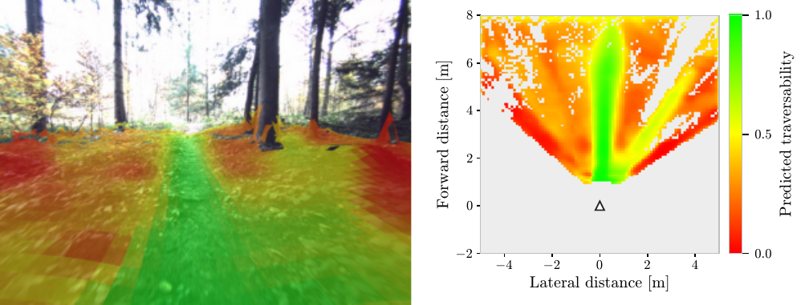
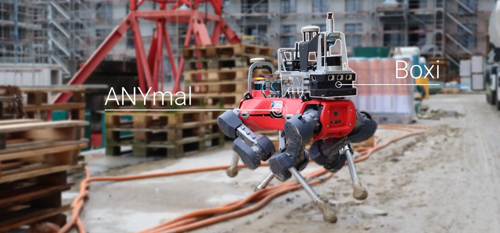
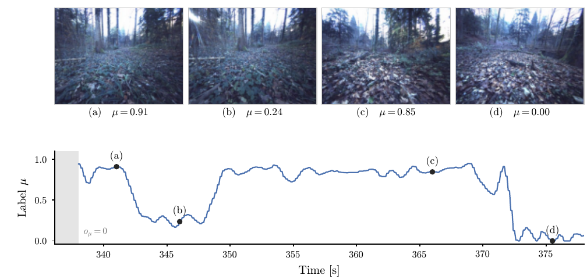
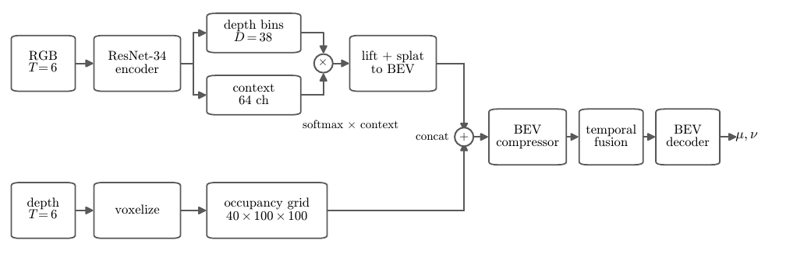
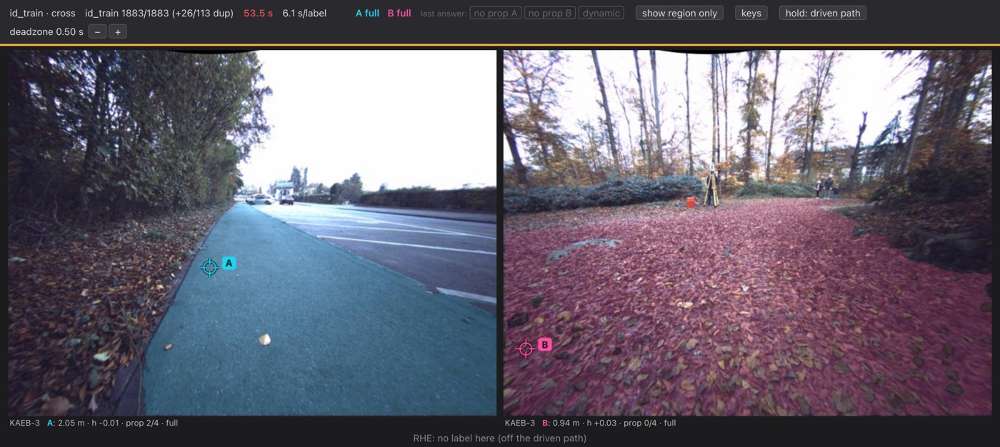

# Data Drift Detection in Traversability Estimation for Safe Mobile Robot Navigation

Code for the master's thesis with the above title.
Traversability estimation (WayFASTER [^1]), adapted to the GrandTour dataset[^2], with RHE-based (μ, ν) labels[^3].

## Abstract

Accurate traversability estimation is essential for safe autonomous navigation. Learned models are often overconfident in environment types they were not trained for, which in the worst case leads to hazardous terrain being classified as traversable. This work combines a traversability estimator with several out-of-distribution (OOD) detection methods.

We train the WayFASTER architecture (Gasparino et al.)[^1] on the forest recordings of the GrandTour dataset under self-supervised labels. The estimator does not generalize across recordings, which our analysis attributes to the severely imbalanced label distribution. Established mitigations for imbalanced data do not resolve this, so we train the estimator on a small set of relative human labels, which is surprisingly effective.

On the resulting estimator we compare six post-hoc detectors along two axes of novelty: visual and semantic. No single detector performs well on both axes, and their failure modes are complementary. An equally weighted ensemble of three detectors is the only method that separates every group of OOD recordings from in-distribution ones.

## Brief overview

For more details, see the [thesis](documentation/lmertens_master_thesis.pdf) or the [presentation](documentation/lmertens_master_presentation.pdf).

*ANYmal[^4] with the Boxi[^5] payload used to record GrandTour. Image: GrandTour dataset, ETH Zurich RSL.*

**1. Preprocessing.** ROS1 bags are extracted to rectified Alphasense images, odometry, commands and calibration. FoundationStereo[^6] provides depth.

**2. Self-supervised labels.** A Receding Horizon Estimator[^3] fits a unicycle model with traction parameters (μ, ν) to commanded versus measured motion.

**3. Estimator.** WayFASTER projects RGB features to a bird's-eye-view grid, fuses them with a regular depth grid over 6 frames, and predicts (μ, ν) per cell.

**4. Relative human labels.** Because the estimator trained on RHE labels does not generalize, it is retrained on pairwise human comparisons (following the W-RIZZ methodology[^7]). Labels are collected with a custom annotation tool.

**5. OOD detection.** Six post-hoc detectors are evaluated on recordings grouped by novelty (near, medium, far):
- Mahalanobis++[^8] on network logits, encoder features and DINOv3[^9] features
- depth-head entropy
- disagreement under a viewpoint change
- disagreement between RGB and RGB+depth inputs

## Repository layout

| Folder | Content |
|---|---|
| `preprocessing/grandtour_extraction/` | ROS1 bag extraction: images, calibration, odometry, commands, ground height, training caches |
| `preprocessing/depth_generation/` | Dockerized FoundationStereo depth |
| `preprocessing/data_labeling_pipeline/` | RHE labeler for per-timestep traversability labels |
| `preprocessing/pipeline.py` | Per-mission CLI to run all preprocessing steps |
| `preprocessing/wayfaster_dataset/` | Alignment, mapping and video tools for the original WayFASTER runs |
| `preprocessing/wayfaster_download/` | GrandTour bag download |
| `training/` | Traversability network, training scripts and configurations |
| `ood_detection/` | OOD detectors, evaluation, reports |
| `shared-utils/` | Shared paths and tier definitions |
| `side_experiments/` | Exploratory work: W-RIZZ human labeling, WVN-style loss[^10], ForEnt dataset[^11], analysis scripts |
| `documentation/` | Notes on dataset, camera choice and WayFASTER issues |

# References

[^1]: M. V. Gasparino, A. N. Sivakumar, G. Chowdhary. *WayFASTER: A Self-Supervised Traversability Prediction for Increased Navigation Awareness.* arXiv:2402.00683, 2024. https://doi.org/10.48550/arXiv.2402.00683
[^2]: J. Frey, T. Tuna, F. Fu, K. Patterson, T. Xu, M. Fallon, C. Cadena, M. Hutter. *GrandTour: A Legged Robotics Dataset in the Wild for Multi-Modal Perception and State Estimation.* arXiv:2602.18164, 2026. https://doi.org/10.48550/arXiv.2602.18164
[^3]: M. V. Gasparino et al. *WayFAST: Navigation with Predictive Traversability in the Field.* IEEE Robotics and Automation Letters 7(4), 10651–10658, 2022. https://doi.org/10.1109/LRA.2022.3193464
[^4]: M. Hutter et al. *ANYmal - A Highly Mobile and Dynamic Quadrupedal Robot.* IEEE/RSJ IROS, 38–44, 2016. https://doi.org/10.1109/IROS.2016.7758092
[^5]: J. Frey et al. *Boxi: Design Decisions in the Context of Algorithmic Performance for Robotics.* arXiv:2504.18500, 2025. https://doi.org/10.48550/arXiv.2504.18500
[^6]: B. Wen, M. Trepte, J. Aribido, J. Kautz, O. Gallo, S. Birchfield. *FoundationStereo: Zero-Shot Stereo Matching.* arXiv:2501.09898, 2025. https://doi.org/10.48550/arXiv.2501.09898
[^7]: A. Schreiber, A. N. Sivakumar, P. Du, M. V. Gasparino, G. Chowdhary, K. Driggs-Campbell. *W-RIZZ: A Weakly-Supervised Framework for Relative Traversability Estimation in Mobile Robotics.* arXiv:2406.02822, 2024. https://doi.org/10.48550/arXiv.2406.02822
[^8]: M. Mueller, M. Hein. *Mahalanobis++: Improving OOD Detection via Feature Normalization.* arXiv:2505.18032, 2025. https://doi.org/10.48550/arXiv.2505.18032
[^9]: O. Siméoni et al. *DINOv3.* arXiv:2508.10104, 2025. https://doi.org/10.48550/arXiv.2508.10104
[^10]: J. Frey, M. Mattamala, N. Chebrolu, C. Cadena, M. Fallon, M. Hutter. *Fast Traversability Estimation for Wild Visual Navigation.* arXiv:2305.08510, 2023. https://doi.org/10.48550/arXiv.2305.08510
[^11]: N. Kirdwichai, D. Tarapore. *ForEnt: A Multi-Modal Dataset for Characterizing Quadruped Robot Entrapments in Forest Environments.* arXiv:2606.19675, 2026. https://doi.org/10.48550/arXiv.2606.19675
