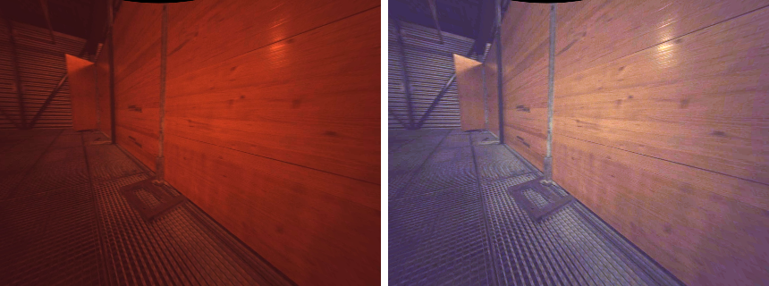
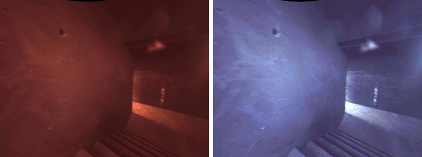
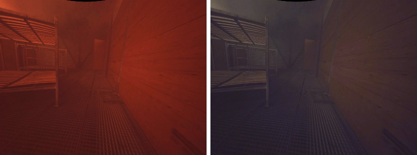

- Some data is only available in ros1 format, but not on huggingface
- Things are not available (cpt7-tc odometry not available for all missions), total station measurements spotty and also not available for entire ds

## Red-tint correction

In dark scenes the front-center Alphasense camera occasionally fails its
auto-white-balance and bakes a strong red cast into the recorded frames.
Affected missions: ARC-5/6/7, SPX-3, parts of ARC and CON

The correction exploits the fact that within an affected mission most frames are correctly balanced. We flag a frame as tinted when its redness ratio, $R / \tfrac{1}{2}(G + B)$ over the valid (non-border) pixels, exceeds 1.5. The clean frames define the true color balance: their median per-channel chroma, computed over a local time window around each tinted frame, gives a reference white point. Each tinted frame is rescaled per channel onto that reference and its brightness matched to the clean frames.
This should keep the corrected frames close to the correct color distribution of the dataset.

